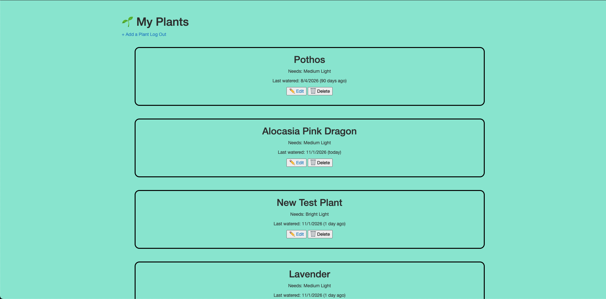
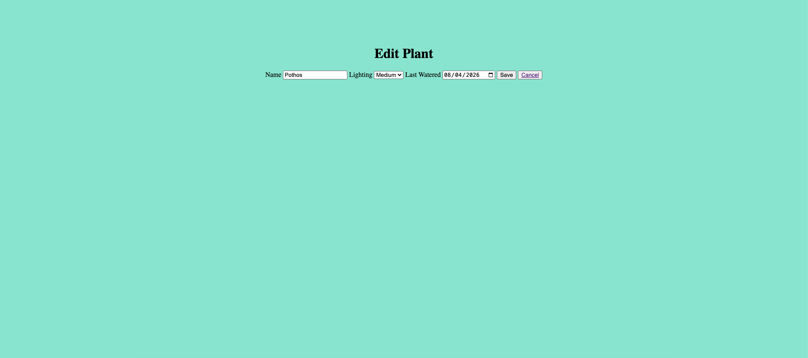

# Plant Tracker

Plant Tracker is a personal app for keeping your houseplants alive. Log in, add the plants you own, note how much light each one needs and when you last watered it; the app flags any plant that has gone a week without water. You'll be able to edit or delete plants any time.

## Demo




## Try it Here!

[Plant Tracker on Render](https://plant-tracker-pcis.onrender.com)

## Features

- Log in and see only your own plants
- Add a plant with a name, light requirement, and last watered date (defaults to today if left blank)
- View every plant in a list, with its last watered date and how many days ago that was
- Edit a plant on its own page, with a form prefilled with the saved details
- Delete a plant and see it disappear without reloading the page

## Built with

- Node.js and Express
- MongoDB with Mongoose
- EJS templates
- Passport for authentication 
- Plain JavaScript, HTML, and CSS

## Getting started

### Prerequisites

- Node.js and npm
- A MongoDB database and its connection string (a free MongoDB Atlas cluster works)

### Installation

1. Clone the repository and move into the project folder:

   ```
   git clone https://github.com/your-username/plant-tracker.git
   cd plant-tracker
   ```

2. Install the dependencies:

   ```
   npm install
   ```

3. Create a `.env` file in the project root and add your MongoDB connection string:

   ```
   MONGO_URI=your_mongodb_connection_string
   ```

4. Start the server:

   ```
   node server.js
   ```

5. Open [http://localhost:8080](http://localhost:8080) in your browser.

<br>
<br>

## Using the App
Create an account or log in, then click Add Plant to log a plant. Fill in the form and save, and the plant appears on your profile page. Use Edit on any plant to change its details or update when you last watered it, or Delete to remove it.
